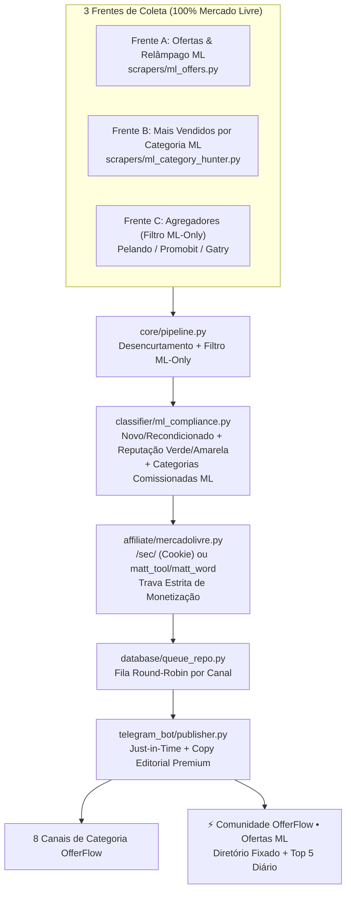

# ⚡ OfferFlow v2.0

**Ecossistema Autônomo 100% Mercado Livre Afiliados para Telegram** — Arquitetura multi-canal (**8 Canais de Categorias Comissionadas + 1 Comunidade Hub Central**), motor de compliance oficial do Programa de Afiliados do Mercado Livre, copy **Editorial Premium**, trava rígida de monetização, gráficos de histórico de preços, alertas pessoais via DM e Vitrine Web integrada.

---

## 🏗️ Arquitetura Modular



---

## 📢 Comunidade Hub & 8 Canais 100% Comissionados no Mercado Livre

| Chave | Nome Padronizado | Cobertura Oficial de Categorias ML |
|---|---|---|
| `hub` | `⚡ Comunidade OfferFlow • Ofertas ML` | Diretório fixado com botões para todos os canais + Pasta de Canais + Top 5 Diário |
| `ofertas_bugs` | `OfferFlow • 🔥 Ofertas Relâmpago & Bugs` | Super descontos ($\ge 45\%$ OFF), Ofertas Relâmpago e campanhas oficiais |
| `tech_celulares` | `OfferFlow • 💻 Tech, Informática & Celulares` | Informática, Celulares, Eletrônicos, Áudio/Vídeo e Câmeras |
| `games_geek` | `OfferFlow • 🎮 Games, Brinquedos & Livros` | Videogames, Jogos, Brinquedos e Livros/HQs (**apenas novos**) |
| `casa_eletro` | `OfferFlow • 🏠 Casa, Eletro & Cozinha` | Eletrodomésticos, Casa, Móveis e Decoração |
| `ferramentas_construcao` | `OfferFlow • 🛠️ Ferramentas & Construção` | Ferramentas elétricas/manuais e Construção |
| `moda_relogios` | `OfferFlow • 👟 Moda, Calçados & Relógios` | Calçados, Roupas, Bolsas, Joias e Relógios |
| `beleza_esportes` | `OfferFlow • 💄 Beleza, Saúde & Esportes` | Beleza, Cuidado Pessoal, Esportes & Fitness e Bem-Estar (sem médicos/farmacêuticos) |
| `pet_bebes_papelaria` | `OfferFlow • 🐾 Pet, Bebês & Papelaria` | Pet Shop (acessórios/rações), Bebês (sem alimentos), Arte, Papelaria, Festas e Instrumentos |

---

## 🛡️ Compliance Oficial do Programa de Afiliados do Mercado Livre

* ✅ **100% Mercado Livre:** Descarta links de outras lojas e páginas genéricas (Home, Categorias, Carrinho, Vendedores, Mercado Shops, Clips).
* ✅ **Apenas Novos ou Recondicionados:** Bloqueia produtos usados; em **Livros, Revistas e Quadrinhos**, permite estritamente **Novos**.
* ✅ **Reputação de Vendedor Verde ou Amarela:** Bloqueia vendedores com reputação Laranja ou Vermelha.
* ✅ **Zero Categorias Sem Comissão / Proibidas:** Bloqueia automaticamente **Alimentos e Bebidas** (não geram ganhos), alimentos para bebês, produtos médicos e farmacêuticos, venda de animais vivos, agro, veículos, imóveis, serviços, ingressos, mídia física (CD/DVD/Blu-ray) e empréstimos.
* 🔒 **Trava de Monetização (`REQUIRE_AFFILIATE_LINK=true`):** Jamais publica links sem o seu parâmetro de afiliado Mercado Livre (`/sec/`, `meli.la` ou `matt_tool`).

---

## 🚀 Instalação e Configuração Rápida

### 1. Instalar Dependências e Preparar `.env`
```bash
python -m venv .venv
source .venv/bin/activate  # ou .venv\Scripts\activate no Windows
pip install -r requirements.txt
cp .env.example .env
```
Preencha `TELEGRAM_BOT_TOKEN` (e opcionalmente `ADMIN_USER_IDS`) no `.env`.

### 2. Rodar Testes e Autodiagnóstico
```bash
python -m pytest -v
python main.py --check
```

### 3. Iniciar o Bot e Configurar em 3 Passos pelo Telegram
```bash
python main.py
```
1. **Ative seu afiliado ML automaticamente:** Envie no privado do Bot `/configurar_afiliado <cole qualquer link de afiliado seu do Mercado Livre>` (o Bot extrai seu `matt_tool` e `matt_word` automaticamente).
2. **Vincule a Comunidade Hub e os 8 Canais:** Crie os canais no Telegram, adicione o Bot como Administrador e poste `/vincular hub`, `/vincular ofertas_bugs`, `/vincular tech_celulares`, etc. dentro de cada canal — o Bot renomeia o canal, aplica a descrição, fixa as boas-vindas e atualiza o diretório da Comunidade Hub automaticamente!
3. **Adicione a Pasta Compartilhável (opcional):** Crie uma Pasta no Telegram agrupando a Comunidade e os 8 canais, gere o link `t.me/addlist/...` e envie `/pasta <link>` no privado do Bot.
