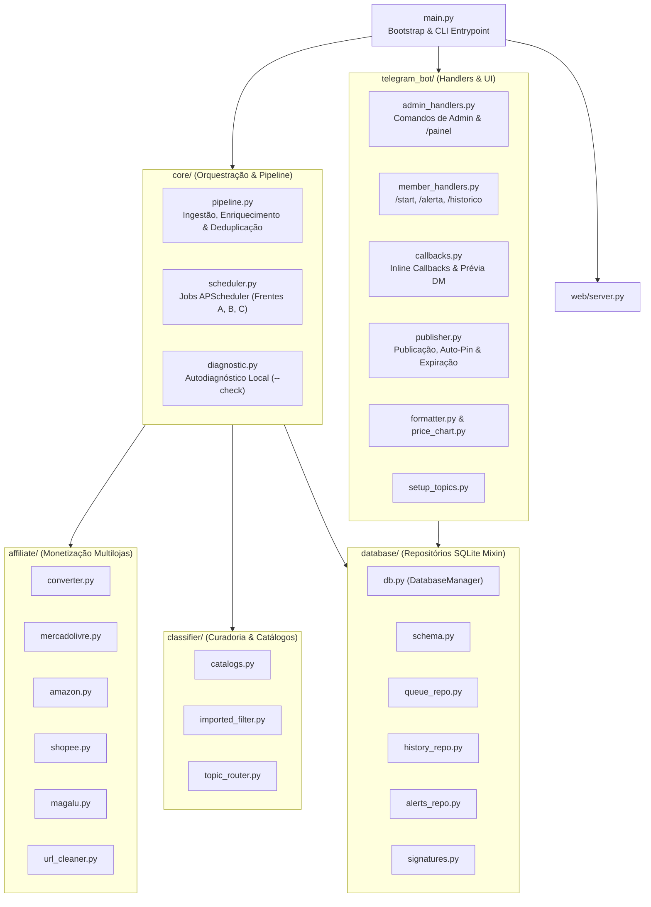

# ⚡ OfferFlow

**Autonomous Telegram Supergroup Deals & Imported Goods Ecosystem** — Coleta multi-fonte em tempo real, curadoria semântica com filtro estrito de importados, conversão de links de afiliados multilojas, gráficos de histórico de preços, alertas pessoais via DM e Vitrine Web integrada.

---

## 🏗️ Arquitetura Modular



---

## ✨ Principais Funcionalidades

1. **Coleta Autônoma em 3 Frentes (`scrapers/`):**
   - **Frente A (Agregadores):** Monitoramento assíncrono de Pelando, Promobit e Gatry com decodificação de links de clickout e enriquecimento direto na página da loja.
   - **Frente B (Ofertas Oficiais Mercado Livre):** Coleta de Ofertas do Dia e Ofertas Relâmpago com filtro de nota mínima ($\ge 4.0 \star$).
   - **Frente C (Caçador Rotativo de Importados):** Busca circular focada em chocolates, doces, massas, azeites, molhos e bebidas 100% importadas.
2. **Roteamento Inteligente em 6 Tópicos Oficiais (`classifier/`):**
   - `🔥 Bugs, Cupons & Imperdíveis` (com Auto-Pin para descontos $\ge 60\%$ OFF)
   - `💻 Tecnologia, PC & Games`
   - `🍫 Doces & Chocolates Importados`
   - `🛒 Comidas & Bebidas Importadas`
   - `🏠 Casa, Cozinha & Eletro`
   - `👕 Moda, Beleza & Perfumes`
3. **Monetização Multilojas (`affiliate/`):**
   - Limpeza automática de parâmetros de terceiros e conversão para **Mercado Livre** (Linkbuilder `/sec/` via Cookie + fallback automático `matt_tool`/`matt_word`), **Amazon** (`tag`), **Shopee** (OpenAPI GraphQL `s.shopee.com.br` + fallback parametrizado) e **Parceiro Magalu** (`magazinevoce.com.br`).
4. **Engajamento e Ferramentas para Membros (`telegram_bot/`):**
   - **Alertas Pessoais no Privado (`/alerta`, `/meus_alertas`, `/remover_alerta`):** Notificação instantânea via DM quando um produto desejado entra em oferta abaixo do teto escolhido.
   - **Gráfico Visual de Histórico de Preços (`/historico <termo>`):** Geração de card PNG em modo escuro (`Pillow`) com curva de evolução, menor preço registrado e média.
   - **Detector de Oferta Encerrada & Auto-Limpeza:** Revalidação Just-in-Time antes de postar, marcação de ofertas esgotadas e exclusão automática configurável.
5. **Vitrine Web Pública / Mini-App (`web/server.py`):**
   - Interface web responsiva em modo escuro com filtro por tópico, busca em tempo real e endpoints JSON (`/api/offers` e `/api/stats`).

---

## 🚀 Como Executar

### 1. Instalação de Dependências
```bash
python -m venv .venv
source .venv/bin/activate  # Linux/macOS
# ou .venv\Scripts\activate no Windows
pip install -r requirements.txt
```

### 2. Configuração de Ambiente
Copie o arquivo de exemplo e preencha suas credenciais locais:
```bash
cp .env.example .env
```

### 3. Autodiagnóstico e Testes
```bash
python main.py --check
python -m pytest -v
```

### 4. Iniciar o Bot
```bash
python main.py
```

---

## 📂 Estrutura de Diretórios

```text
OfferFlow/
├── affiliate/          # Limpeza de URLs e conversores (ML, Amazon, Shopee, Magalu)
├── classifier/         # Catálogos, filtro estrito de importados e roteador de tópicos
├── core/               # Pipeline de ingestão, agendador APScheduler e diagnóstico
├── database/           # SQLite WAL com Mixins (schema, fila, histórico, alertas, logger)
├── scrapers/           # Coletores assíncronos (Pelando, Promobit, Gatry, ML)
├── telegram_bot/       # Handlers de Admin/Membros, callbacks, formatter e gráfico PNG
├── tests/              # Suíte de testes de pipeline e auditoria de segurança anti-vazamento
├── web/                # Servidor HTTP da Vitrine Web / Mini-App do Telegram
├── config.py           # Carregamento tipado de variáveis de ambiente (.env)
├── main.py             # Ponto de entrada enxuto da aplicação
└── requirements.txt    # Dependências do projeto
```
